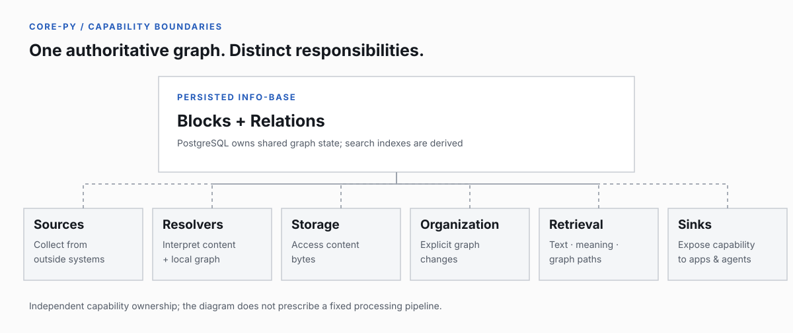

# InKCre Core

**The Python Peer behind InKCre's persistent information base.**

`core-py` implements information persistence, collection, organization, retrieval, and Agent-facing capabilities. It is part of [InKCre](https://github.com/InKCre), a self-hostable system that keeps information usable beyond its original source.

[Project overview](https://github.com/InKCre) · [Shared architecture](https://github.com/InKCre/docs/blob/main/20-product-tdd/unit-topology.md) · [Web clients](https://github.com/InKCre/client-web) · [Contributing](CONTRIBUTING.md)

<p align="center">
  
</p>

## What this repository owns

| Area | Responsibility |
| --- | --- |
| **Info-base** | Persist addressable Blocks and directed Relations as the shared information graph. |
| **Collection & Organization** | Bring external information in; explicitly improve existing information when requested. |
| **Resolvers & Storage** | Interpret content and graph context separately from the mechanism that retrieves or stores bytes. |
| **Retrieval** | Provide lexical, semantic, and graph-navigation capabilities without making one strategy the universal search pipeline. |
| **Sinks & Agents** | Expose information through interfaces including MCP and Agent-composed queries. |
| **Extensions & Peers** | Host first-party and installed capabilities; participate in the shared Peer protocol without claiming to be the only possible runtime. |

The persisted graph is authoritative. Search indexes and embeddings are **derived support**, and Agent interpretations do not silently overwrite source-authored facts. The detailed contracts belong to [shared product documentation](https://github.com/InKCre/docs) and [local unit design](docs/30-unit-tdd/README.md).

## Local development

You will need the Python/PDM toolchain required by this repository, Docker for the default local database provider, and the SVC CLI used by the declared development capabilities. See [Contributing](CONTRIBUTING.md) for the exact toolchain and setup expectations.

```bash
git submodule update --init --recursive
pdm install -G dev --frozen-lockfile
svc dev ensure database --repo . --json
```

The declared `database` capability provisions the local runtime — PostgreSQL with pgvector, initialized database state, core-py, and PostgREST. A machine-local `svc.local.json` can select a validated SSH Docker provider instead; such host-specific configuration stays out of the repository.

For core-only iteration against an initialized database:

```bash
pdm run dev
```

For validation and environment diagnostics:

```bash
pdm run doctor
pdm run check
```

`pdm run check` is the repository's CI-aligned verification command. Refer to [Contributing](CONTRIBUTING.md) for narrower checks, migration procedures, and release rules.

## Self-hosting

A fork owner can deploy a separate InKCre Core and PostgREST environment using GitHub Actions, **Neon**, and either **Render** or **Heroku**, without cloning this repository locally.

- [Render + Neon: setup, availability limits, and cleanup](docs/40-deployment/render-neon-self-host.md)
- [Heroku + Neon: setup and operations](docs/40-deployment/heroku-neon-self-host.md)

These are owner-managed deployments, independent of the project's own environment. **Protect the JWT signing secret**: it grants full admitted Peer authority. In particular, free hosting tiers can have sleep and scheduling limitations; read the selected deployment guide before using it for ongoing work.

## Documentation and API

- [Local unit design](docs/30-unit-tdd/README.md) — retrieval, MCP, database boundaries, and extension implementations.
- [Deployment and runtime](docs/40-deployment/README.md) — development databases, containers, migrations, self-hosting, and observability.
- [Shared product model](https://github.com/InKCre/docs/tree/main/10-prd) — behavior and vocabulary owned across InKCre repositories.
- [Cross-unit technical contracts](https://github.com/InKCre/docs/tree/main/20-product-tdd) — interoperability and authority boundaries.
- [OpenAPI schema](docs/openapi.json) — checked-in API artifact; regenerate with `pdm run python scripts/generate-openapi.py`.
- [Security policy](SECURITY.md) — report suspected vulnerabilities privately.

Shared product documentation is referenced through the read-only `docs/_shared/` submodule. Make shared changes in [`InKCre/docs`](https://github.com/InKCre/docs), then update the pinned reference; do not edit its mounted files in place.

**Implementation:** Python · FastAPI · SQLModel/SQLAlchemy · PostgreSQL/pgvector · APScheduler · MCP.
